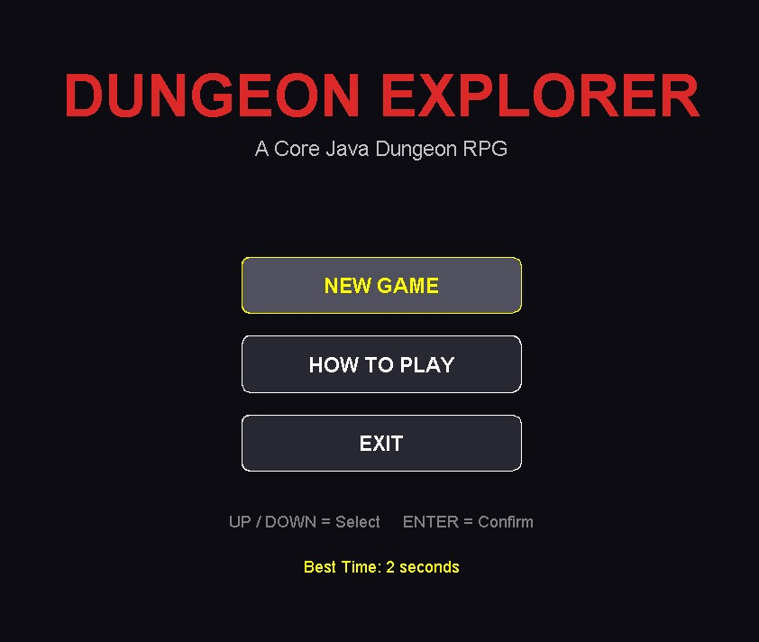
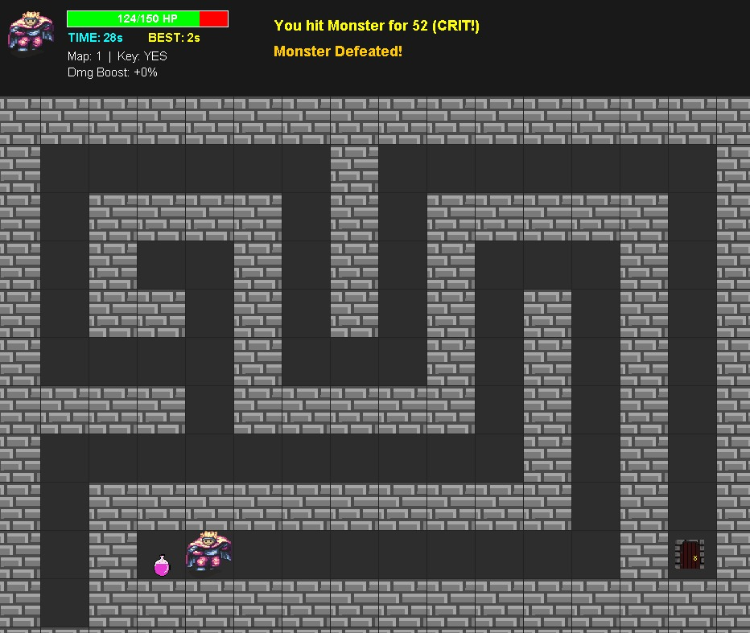
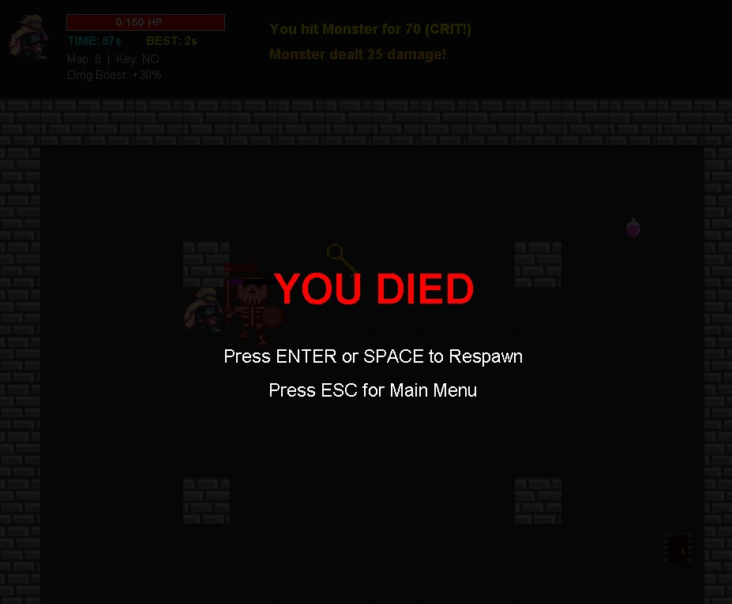
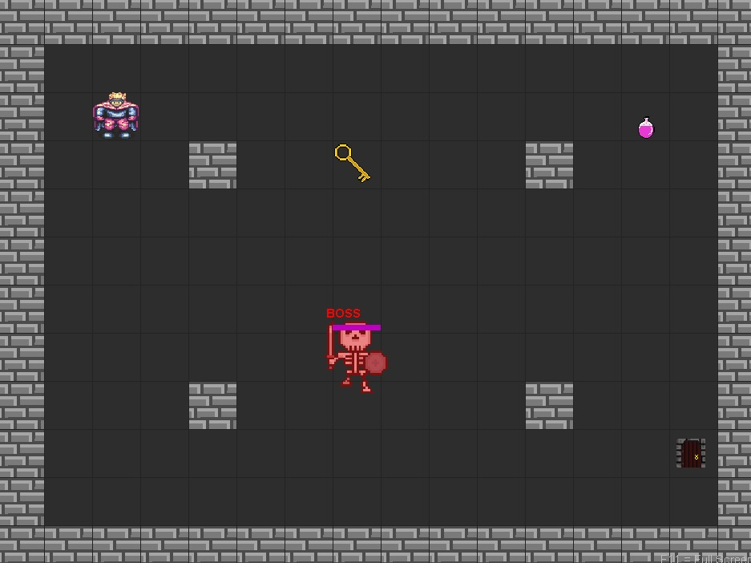

#  DONWLOAD_INSTRUCTION
    Inorder to prevent further errors place the Game.jar,maps on same folder
# 🗡️ Dungeon Explorer

**Dungeon Explorer** is a 2D pixel-art dungeon adventure game developed using Core Java and Java Swing. Players explore multiple dungeon levels, collect items, fight monsters, unlock doors, and ultimately defeat the final boss.

The game combines exploration, turn-based combat, resource management, and a time-based scoring system to create an engaging RPG experience.

## 🎮 Game Features

- **Multiple Dungeon Levels:** Explore 8 different maps, each with its own challenges.
- **Player Animation:** Sprite-sheet-based character animations with directional movement.
- **Enemy AI:** Monsters patrol within a defined range of their starting positions.
- **Combat System:** Fight enemies using randomized damage and critical hits.
- **Boss Battle:** Face a powerful final boss with increased health and damage.
- **Inventory System:** Collect keys, health potions, and treasure chests.
- **Damage Upgrades:** Chests permanently increase player damage by 5% during a run.
- **Health Management:** Collect potions to restore lost health.
- **Game Statistics:** Monitor player health, current level, inventory, damage boosts, and completion time.
- **Pause System:** Pause and resume gameplay whenever needed.
- **Fullscreen Support:** Switch between windowed and fullscreen modes.
- **High Score System:** Automatically records completed runs and maintains a fastest-first leaderboard using CSV file storage.

## 🕹️ Controls

| Key | Action |
|---|---|
| W / ↑ | Move Up |
| A / ← | Move Left |
| S / ↓ | Move Down |
| D / → | Move Right |
| ENTER / SPACE | Select menu option / Restart |
| TAB | Toggle Game Statistics |
| P | Pause / Resume |
| ESC | Return to Main Menu |
| F11 | Toggle Fullscreen |

## ⚔️ Gameplay

The objective is to navigate through the dungeon levels, collect essential items, defeat enemies, and reach the final boss.

### Items and Objects

| Object | Description |
|---|---|
| 🔑 Key | Required to unlock the exit door. |
| 🚪 Door | Allows progression to the next dungeon level. |
| 🧪 Potion | Restores up to 37 HP. |
| 📦 Treasure Chest | Increases player damage by 5%. |
| 👾 Monster | Enemy that patrols the dungeon and attacks when adjacent. |
| 👹 Final Boss | A stronger enemy encountered in the final dungeon. |

### Combat Mechanics

- Combat is automatically initiated when the player and an enemy are adjacent.
- Player attacks deal randomized damage.
- Critical hits have a 40% probability and deal double damage.
- Enemies retaliate with randomized damage.
- Combat exchanges occur at timed intervals.
- Defeating enemies is necessary to proceed through blocked exits.

## 🛠️ Technologies Used

- **Language:** Java
- **GUI Framework:** Java Swing
- **Graphics:** Java AWT and BufferedImage
- **Image Processing:** Java ImageIO
- **File Handling:** Java I/O and NIO
- **Data Storage:** CSV-based high score management
- **IDE:** Visual Studio Code

## 📂 Project Structure

```text
Dungeon-Explorer/
│
├──Game.java
│
├── maps/
│   ├── map1.txt
│   ├── map2.txt
│   ├── map3.txt
│   ├── map4.txt
│   ├── map5.txt
│   ├── map6.txt
|   ├── map7.txt
│   └── boss.txt
│
├── objects/
│   ├── key.png
│   ├── door.png
│   ├── chest.png
│   ├── potion.png
│   └── monster.png
│
├── player/
│   └── player.png
│
├── tiles/
│   └── wall.png
|   └── (earth,sand,water).png #Future addition
│
├── HIGHSCORE.csv
│
└── README.md
```


## 💾 High Score Management

Dungeon Explorer maintains a record of successful game completions using `HIGHSCORE.csv`.

- Each successful run is assigned a unique run number.
- Completion times are stored in seconds.
- Records are sorted in ascending order of completion time.
- The fastest completion time is displayed as the best record.
- A temporary file is used during updates to reduce the risk of losing existing records.

## 📸 Screenshots

### Main Menu


### Gameplay




### Boss Battle



## 🔮 Future Improvements(Maybe)

- Additional dungeon environments and enemy types.
- More weapons and combat abilities.
- Sound effects and background music.
- Improved enemy pathfinding and behavior.
- Additional player animations.
- More inventory items and power-ups.

## 👨‍💻 Contributors

Developed as a collaborative Java project.
(Will be added..)

## 📄 License

This project is intended for educational purposes.If you are so as impressed then go on:)
